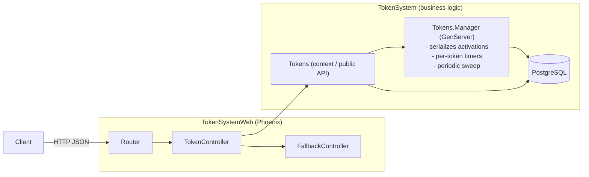
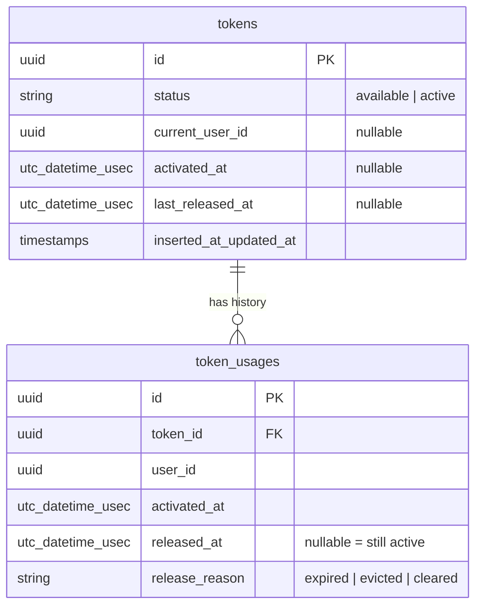
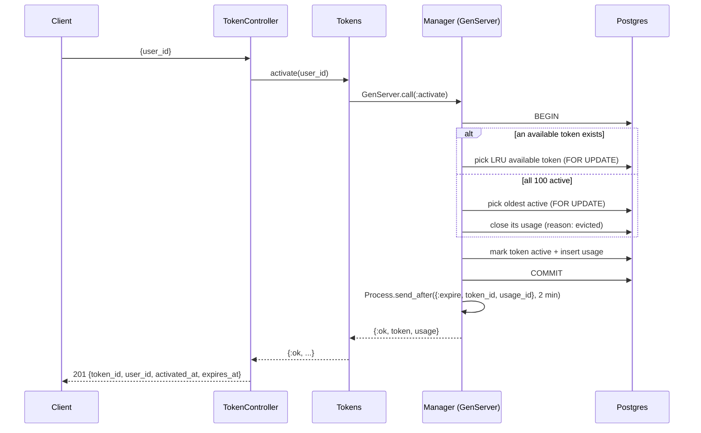

# 01 — Problem Solving & Design

> Challenge criteria: **Resolução de Problemas** and **Design e Arquitetura**.
> Goal of this doc: turn the slides into precise rules, resolve ambiguities explicitly,
> and justify the architecture so it can be defended in the technical interview.

---

## 1. Requirements (from the brief)

### Business rules
| # | Rule |
|---|---|
| R1 | There are exactly **100 tokens**, each identified by a **UUID**, **pre-generated** (seeded). |
| R2 | Tokens are **never created or deleted** at runtime — they only toggle between `available` and `active`. |
| R3 | At most **100 tokens active** at the same time. |
| R4 | A token can be active for at most **2 minutes**; then it is **released automatically**. |
| R5 | If a new activation is requested and **all 100 are active**, the **oldest active token is released** and then granted. The request never fails for lack of tokens. |
| R6 | A token has **at most one active user** at a time; the user is identified by a **UUID**. |
| R7 | A token keeps a **history** of every user that has used it. |

### API operations
| Operation | Returns |
|---|---|
| Register usage (activate) a token | token ID + user ID |
| List all tokens (available and active) | list of tokens |
| Get a specific token and its user | token info + active user (or usage history) |
| Get a token's usage history | list of users that used the token |
| Clear active tokens | confirmation that active tokens were released |

### Technical constraints
- Elixir + Phoenix for the API.
- PostgreSQL + Ecto for persistence.
- Public GitHub repo, complete README, runs locally for a live demo.

---

## 2. Ambiguities and the decisions we took

Writing these down is part of "problem solving": a reviewer wants to see that you **noticed** them.

| # | Ambiguity | Decision | Why |
|---|---|---|---|
| A1 | Slide 4 labels are swapped ("Processo Supervisionado" describes TTL, "Job Periódico" describes eviction). Slide 6 says the strategy is free. | Treat both as **rules** (TTL + eviction), choose our own mechanism (§3). | Slide 6 is explicit that the approach is the candidate's choice. |
| A2 | "Limpar Tokens Ativos" — remove what? | **Release** every active token (close their usages). Nothing is deleted. | R2 forbids deleting tokens. |
| A3 | With exactly 100 tokens, "limit of 100 active" = "no token available". | Eviction triggers when **no available token exists**. | Same condition, simpler to reason about. |
| A4 | Who generates the user UUID? | **Client sends** `user_id` in the body; we validate it is a UUID. | Users are external to this system; we only track them. |
| A5 | Can one user hold several active tokens at once? | **Yes** (my call — revisit if you disagree). Each activation is independent. | The brief only constrains *one user per token*, not *one token per user*. |
| A6 | Which available token is handed out? | The one **released longest ago** (least recently used); never-used first. | Spreads usage evenly; deterministic, so it's testable. |
| A7 | Is the 2-minute limit exact? | Timer fires at 2 min (ms precision); the sweep guarantees release within **2 min + sweep interval** in the worst case (e.g. after a crash). | Documented trade-off instead of a hidden one. |
| A8 | What happens after a restart? | On boot, expired tokens are released and timers are re-armed for the remaining active ones. | DB is the source of truth; memory is only a cache of timers. |

---

## 3. Auto-release strategy — options and the choice

| Option | How it works | Pros | Cons |
|---|---|---|---|
| A. Pure OTP | A supervised GenServer arms `Process.send_after/3` per activation | Showcases OTP, zero deps, ms precision | Timers live in memory → lost on crash/restart |
| B. Oban | Each activation schedules a job in Postgres for +2 min | Durable, retries, good test helpers | Extra dependency, ~1 s precision, heavier for 100 rows |
| C. Periodic sweep only | Every N s, release rows with `activated_at <= now - 2 min` | Simplest, naturally durable | Release can be up to N s late |
| **D. Hybrid ✅** | **A for precision + C as safety net + boot recovery** | Precise *and* survives crashes; great interview story | A few more moving parts to test |

**Chosen: D (Hybrid).** The database is always correct; the GenServer adds precision.

---

## 4. Architecture



### Layers and responsibilities
| Module | Responsibility |
|---|---|
| `TokenSystemWeb.TokenController` | HTTP only: parse params, call the context, render JSON. **No business logic.** |
| `TokenSystem.Tokens` | The **context**: the only public API for token operations. Reads go straight to the DB; writes go through the Manager. |
| `TokenSystem.Tokens.Manager` | GenServer. **Single writer**: activate, release (expire / evict / clear), timers, sweep, boot recovery. |
| `TokenSystem.Tokens.Token`, `TokenUsage` | Ecto schemas + changesets. |
| `TokenSystem.Tokens.Queries` | Composable Ecto queries (available, oldest active, expired...). |

### Supervision tree
```
TokenSystem.Supervisor (one_for_one)
├── TokenSystemWeb.Telemetry
├── TokenSystem.Repo
├── Phoenix.PubSub
├── TokenSystem.Tokens.Manager      ← starts after Repo (order matters)
└── TokenSystemWeb.Endpoint
```
If the Manager crashes, the supervisor restarts it and its `init` runs boot recovery (§6.5) — no state is lost because the state is in Postgres.

---

## 5. Data model



### Constraints enforced by the database (defense in depth)
- `CHECK (status IN ('available','active'))`
- `CHECK ((status = 'active') = (current_user_id IS NOT NULL AND activated_at IS NOT NULL))`
- **Partial unique index** `token_usages(token_id) WHERE released_at IS NULL` → the DB itself guarantees **R6** (one active user per token).
- Index on `tokens(activated_at) WHERE status = 'active'` → fast "oldest active" lookup.
- Seeds insert exactly 100 tokens; no API endpoint creates or deletes tokens (**R1, R2**).

---

## 6. Flows

### 6.1 Activate (`POST /api/tokens/activate`)


### 6.2 Expire (timer fires)
The message carries the **`usage_id`**, not just the `token_id`.
If the token was evicted and re-activated by another user in the meantime, the old timer
arrives with a stale `usage_id` → **ignored**. Without this, a stale timer would release
the *new* user's token early. (Great interview talking point.)

### 6.3 Sweep (every `sweep_interval`, default 5 s)
`release all usages where released_at IS NULL AND activated_at <= now - ttl` (reason `expired`).
Idempotent: releasing is a conditional update, so racing with a timer is harmless.

### 6.4 Clear (`DELETE /api/tokens/active`)
Release all active tokens in one transaction (reason `cleared`); return how many were released.
Outstanding timers become stale and are ignored (see 6.2).

### 6.5 Boot recovery (`init/1` → `handle_continue/2`)
1. Release everything already expired.
2. For each still-active token, arm a timer for the **remaining** time.

---

## 7. Concurrency — the hidden test

Two simultaneous requests must never get the same token or exceed 100 active.

- **Primary guarantee:** all writes go through **one GenServer** → they are processed one at a time.
- **Second guarantee:** the transaction uses `FOR UPDATE` and the partial unique index makes a double-activation impossible at the DB level.
- **Proven by a test:** fire 300 concurrent activations and assert ≤ 100 active and no token with two open usages (see doc 04).

**Known trade-off:** a single GenServer is a global serialization point. For 100 tokens and the
expected load that's fine (each call is one short transaction). Evolution paths (interview material):
- Multiple app nodes → the GenServer is per node, so move the guarantee into the DB
  (`SELECT ... FOR UPDATE SKIP LOCKED`, or a Postgres advisory lock), or register the Manager
  globally (`:global` / Horde).
- Durable scheduling across nodes → Oban.
- Live updates to clients → broadcast `token_released` / `token_activated` via Phoenix.PubSub/Channels.

---

## 8. API contract (draft)

| Method | Path | Body | Success |
|---|---|---|---|
| `POST` | `/api/tokens/activate` | `{"user_id": "<uuid>"}` | `201` `{"data": {"token_id", "user_id", "activated_at", "expires_at"}}` |
| `GET` | `/api/tokens` | — (`?status=available\|active` optional) | `200` `{"data": [token...]}` |
| `GET` | `/api/tokens/:id` | — | `200` `{"data": {token..., "active_user": {...}\|null}}` |
| `GET` | `/api/tokens/:id/usages` | — | `200` `{"data": [usage...]}` newest first |
| `DELETE` | `/api/tokens/active` | — | `200` `{"data": {"released_count": n}}` |
| `GET` | `/api/openapi` · `/swaggerui` | — | OpenAPI spec / Swagger UI |

Errors (single shape): `{"errors": {"detail": "...", "fields": {...}}}`
- `400`/`422` invalid or missing `user_id`
- `404` unknown token id (also for a malformed UUID in the path)

---

## 9. Configuration

```elixir
# config/config.exs
config :token_system, TokenSystem.Tokens,
  ttl_ms: :timer.minutes(2),
  sweep_interval_ms: :timer.seconds(5),
  pool_size: 100

# config/test.exs — tests never sleep for 2 real minutes
config :token_system, TokenSystem.Tokens,
  ttl_ms: 200,
  sweep_interval_ms: 50
```
