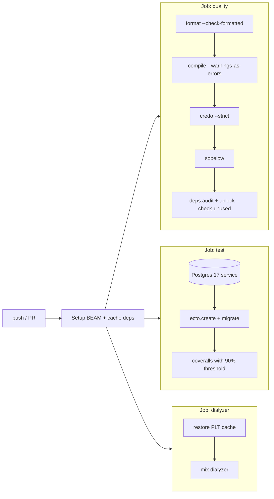

# 05 — CI Pipeline (GitHub Actions)

> Automates docs 02 (quality) and 04 (tests) on every push and pull request.
> A green badge in the README is the first thing a reviewer sees.

---

## 1. Pipeline overview



Three **parallel jobs** → fast feedback; any failure blocks the merge (branch protection on `main`).

| Job | Fails when | Typical time |
|---|---|---|
| `quality` | unformatted code, warnings, Credo issues, security findings, vulnerable/unused deps | ~1 min |
| `test` | any failing test or coverage < 90% | ~1–2 min |
| `dialyzer` | typespec inconsistencies | ~1 min cached (≈5 min first run) |

## 2. Workflow file (proposal)

`.github/workflows/ci.yml`
```yaml
name: CI

on:
  push:
    branches: [main]
  pull_request:

env:
  MIX_ENV: test
  ELIXIR_VERSION: "1.19.5"
  OTP_VERSION: "28"

jobs:
  quality:
    runs-on: ubuntu-latest
    steps:
      - uses: actions/checkout@v4
      - uses: erlef/setup-beam@v1
        with:
          elixir-version: ${{ env.ELIXIR_VERSION }}
          otp-version: ${{ env.OTP_VERSION }}
      - uses: actions/cache@v4
        with:
          path: |
            deps
            _build
          key: ${{ runner.os }}-mix-${{ env.OTP_VERSION }}-${{ env.ELIXIR_VERSION }}-${{ hashFiles('mix.lock') }}
      - run: mix deps.get
      - run: mix format --check-formatted
      - run: mix compile --warnings-as-errors
      - run: mix credo --strict
      - run: mix sobelow --config --exit
      - run: mix deps.audit
      - run: mix deps.unlock --check-unused

  test:
    runs-on: ubuntu-latest
    services:
      postgres:
        image: postgres:17
        env:
          POSTGRES_USER: postgres
          POSTGRES_PASSWORD: postgres
        ports: ["5432:5432"]
        options: >-
          --health-cmd pg_isready
          --health-interval 5s
          --health-timeout 5s
          --health-retries 10
    steps:
      - uses: actions/checkout@v4
      - uses: erlef/setup-beam@v1
        with:
          elixir-version: ${{ env.ELIXIR_VERSION }}
          otp-version: ${{ env.OTP_VERSION }}
      - uses: actions/cache@v4
        with:
          path: |
            deps
            _build
          key: ${{ runner.os }}-mix-${{ env.OTP_VERSION }}-${{ env.ELIXIR_VERSION }}-${{ hashFiles('mix.lock') }}
      - run: mix deps.get
      - run: mix ecto.create
      - run: mix ecto.migrate
      - run: mix coveralls.github   # enforces minimum_coverage from coveralls.json
        env:
          GITHUB_TOKEN: ${{ secrets.GITHUB_TOKEN }}

  dialyzer:
    runs-on: ubuntu-latest
    env:
      MIX_ENV: dev
    steps:
      - uses: actions/checkout@v4
      - uses: erlef/setup-beam@v1
        with:
          elixir-version: ${{ env.ELIXIR_VERSION }}
          otp-version: ${{ env.OTP_VERSION }}
      - uses: actions/cache@v4
        with:
          path: |
            deps
            _build
            priv/plts
          key: ${{ runner.os }}-plt-${{ env.OTP_VERSION }}-${{ env.ELIXIR_VERSION }}-${{ hashFiles('mix.lock') }}
      - run: mix deps.get
      - run: mix dialyzer --format github
```

Dialyzer PLT location in `mix.exs` so it can be cached:
```elixir
dialyzer: [plt_local_path: "priv/plts", plt_core_path: "priv/plts"]
```
(add `/priv/plts/` to `.gitignore`)

## 3. Local parity

The same checks run locally so CI is never a surprise:

| Local | CI job |
|---|---|
| `mix precommit` (doc 02 §4) | `quality` + `test` |
| `mix dialyzer` | `dialyzer` |
| `docker compose up -d db` | `services.postgres` |

## 4. Repo settings to enable on GitHub

- Branch protection on `main`: require PR, require `quality`, `test`, `dialyzer` to pass.
- Enable "Allow rebase merging", disable "Allow squash merging" (doc 03 §2).
- Dependabot for `mix` and `github-actions` ecosystems (weekly).
- README badges: CI status, coverage.

## 5. Possible evolutions (interview material)

- Matrix build across two Elixir/OTP versions.
- Build and push a Docker image on tags (`build` job) — `mix release` + multi-stage Dockerfile.
- Run `mix test --only concurrency` with `--repeat-until-failure 20` nightly to catch flaky races.
