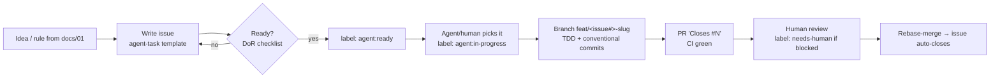

# 06 — Issue-Driven & Agentic Development

> How work flows in this repo: **every change starts as a GitHub issue**, and issues are written
> so that either a human **or an AI agent** (Claude Code, via the GitHub MCP or `gh` CLI) can
> pick one up and deliver a correct PR without asking follow-up questions.

---

## 1. The loop



- **One issue = one PR = a few atomic commits.** If an issue needs > ~300 changed lines, split it.
- The issue is the **spec**; the PR is the **proof** (tests + CI).
- Humans own *what* and *why* (issue, review). Agents can own *how* (implementation) within the issue's boundaries.

## 2. What makes an issue "agent-ready"

Agents fail on vague issues the same way new teammates do — just faster. A good agent issue has:

| Section | Why the agent needs it |
|---|---|
| **Goal** (1–2 sentences) | The outcome, not the steps. |
| **Context / links** | Pointers to `docs/01` rules (R1–R7, A1–A8), files, prior issues. Agents don't know what you know. |
| **Acceptance criteria** (checkboxes, testable) | The agent turns each one into a test. "Works well" is not testable; "returns 404 for unknown id" is. |
| **Scope: in / out** | Prevents the agent from "helpfully" refactoring half the codebase. |
| **Files likely touched** | Narrows the search; reduces wrong-place edits. |
| **Constraints** | Libraries allowed, patterns to follow, things *not* to do. |
| **Verification** | Exact commands that must pass (`mix precommit`, a specific test file). |
| **Dependencies** | `Blocked by #N` — agents must not start blocked work. |

### Definition of Ready (DoR) — before adding `agent:ready`
- [ ] Every acceptance criterion is objectively checkable.
- [ ] Out-of-scope section is filled.
- [ ] Blocking issues are closed.
- [ ] Size is `S` or `M` (an `L` must be split).

## 3. Labels

| Label | Meaning |
|---|---|
| `type:feat` `type:fix` `type:test` `type:chore` `type:docs` `type:ci` | Maps 1:1 to the conventional commit type (doc 03) |
| `area:db` `area:manager` `area:api` `area:openapi` `area:telemetry` `area:infra` | Maps to the commit scope |
| `size:S` `size:M` `size:L` | S < 1h, M = half a day, L = must be split |
| `agent:ready` | Fully specified; an agent may pick it up |
| `agent:in-progress` | Someone (human or agent) is working on it |
| `needs-human` | Agent got blocked / a decision is required |

## 4. Working with issues from Claude Code

### Via GitHub MCP (preferred when connected)
The GitHub MCP server exposes tools such as `issue_write` / `list_issues` / `get_issue` /
`create_pull_request`. Typical prompts:

- *"Read issue #7 in JVMartyns/thiago-bonitao and implement it following AGENTS.md."*
- *"List open issues labeled agent:ready, pick the lowest number not blocked, and start it."*
- *"Draft an agent-task issue for rule R5 (eviction) and create it with labels type:feat, area:manager, size:M."*

**Setup:** the plugin sends `Authorization: Bearer ${GITHUB_PERSONAL_ACCESS_TOKEN}`, so that env
var must exist before launching `claude`:
1. Create a fine-grained PAT (GitHub → Settings → Developer settings) with access to this repo:
   *Issues: RW, Pull requests: RW, Contents: RW, Metadata: R*.
2. Export it in your shell profile (`~/.bashrc`): `export GITHUB_PERSONAL_ACCESS_TOKEN=...`
3. Restart Claude Code and run `/mcp` to confirm `github` is connected.

### Via project skills (shortcuts for the whole loop)
| Skill | What it does |
|---|---|
| `/new-issue <rule, idea or bug>` | Reads docs/01 and existing issues, drafts an issue in the agent-task format, shows it for approval, then creates it with labels |
| `/work-issue <N \| next>` | Claims the issue, branches, writes tests first, implements, runs `mix precommit`, commits conventionally, opens a PR with `Closes #N` (never merges) |

Defined in `.claude/skills/*/SKILL.md`; both are user-invoked only.

### Via `gh` CLI (always works)
```bash
gh issue create --template agent-task.yml                 # interactive, uses the form
gh issue create --title "feat(manager): ..." --body-file issue.md \
  --label "type:feat,area:manager,size:M,agent:ready"
gh issue list --label agent:ready
gh issue view 7
gh issue edit 7 --add-label agent:in-progress --remove-label agent:ready
gh pr create --fill --body "Closes #7"
```

## 5. Guardrails for agents (also in `AGENTS.md`)

- Work only on the issue's scope; open a new issue for anything else you notice.
- Never push to `main`; always branch `<type>/<issue#>-<slug>` and open a PR with `Closes #N`.
- Write the failing test first, then the code.
- `mix precommit` must pass before the PR.
- If an acceptance criterion is ambiguous: stop, comment on the issue, add `needs-human`.
- A human reviews and merges every PR.

## 6. Backlog seed

The planned commit story in doc 03 §4 becomes the initial issue backlog (≈15 issues), each
grouping 1–3 commits, linked by `Blocked by #N` in the same order.
